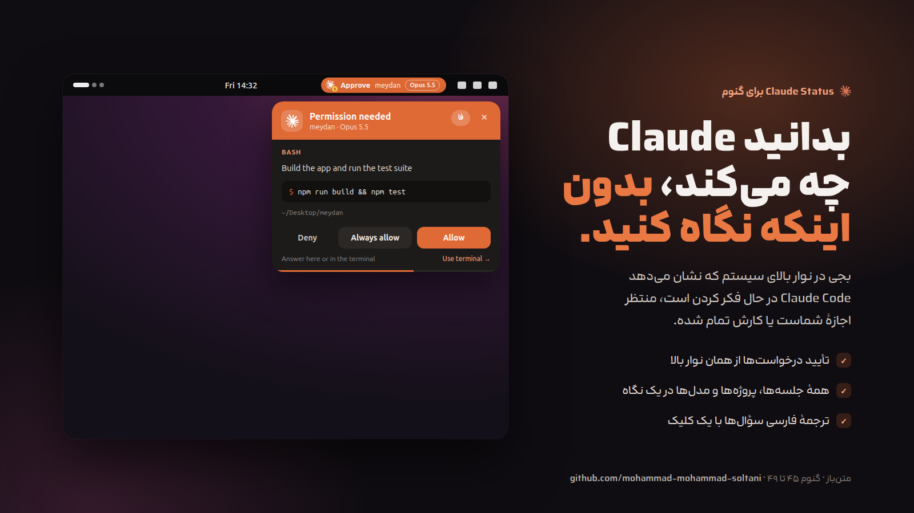
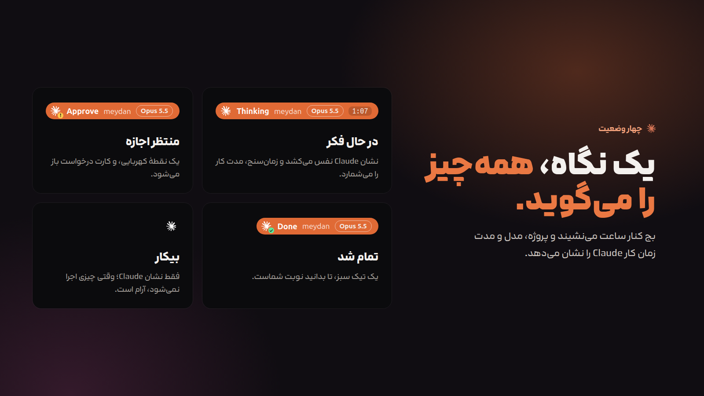
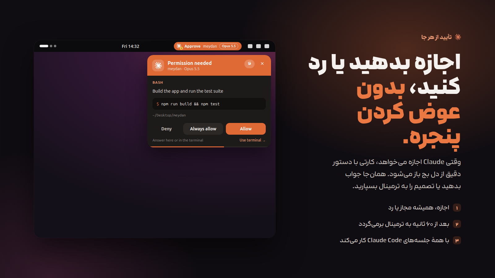
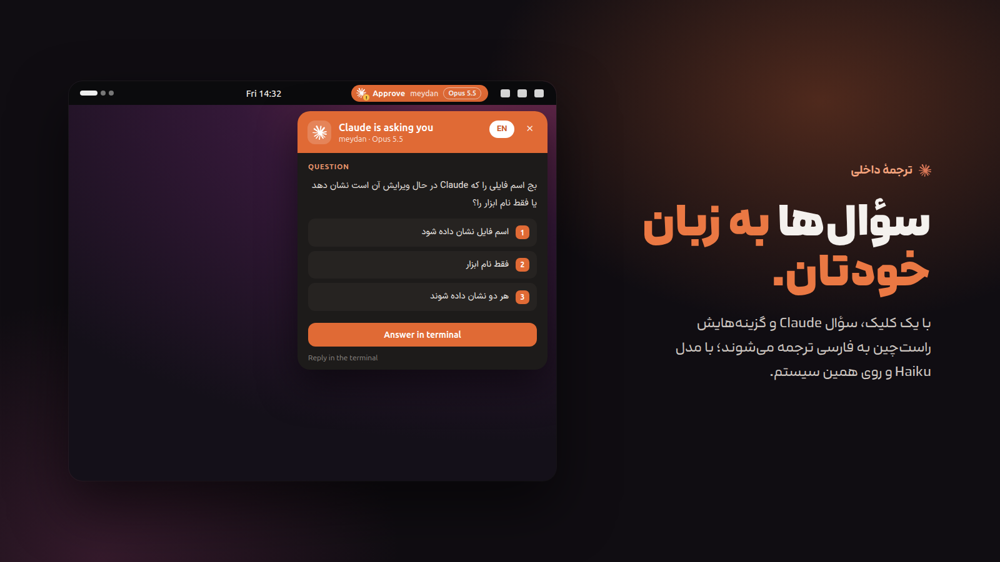
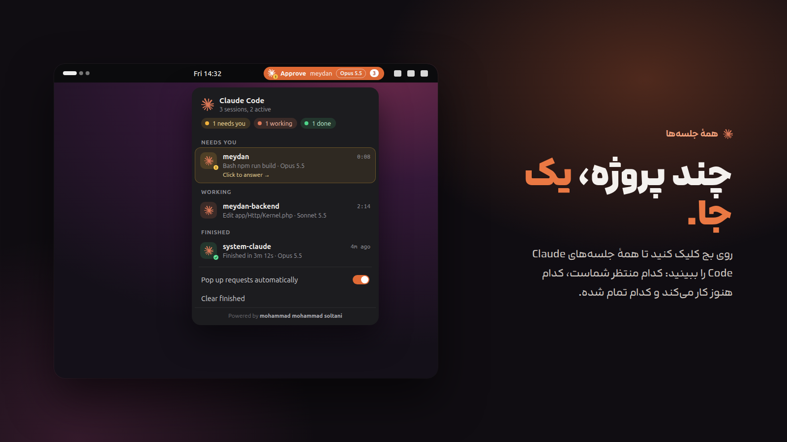
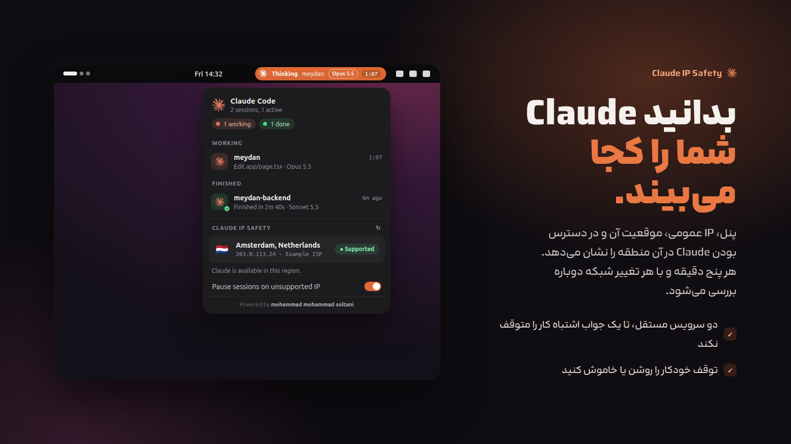
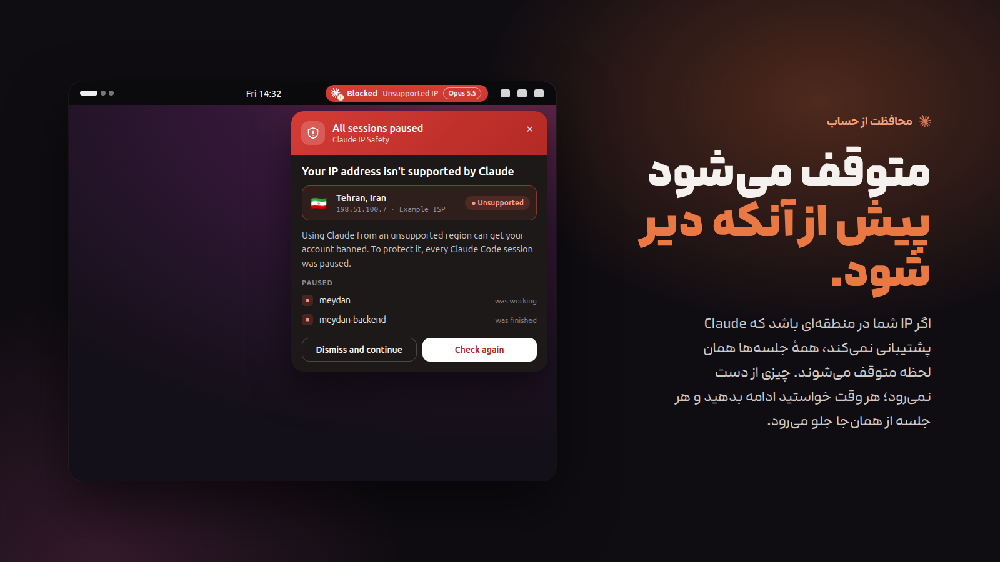
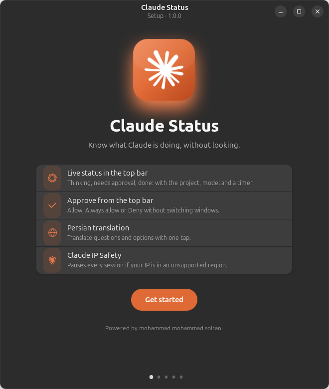
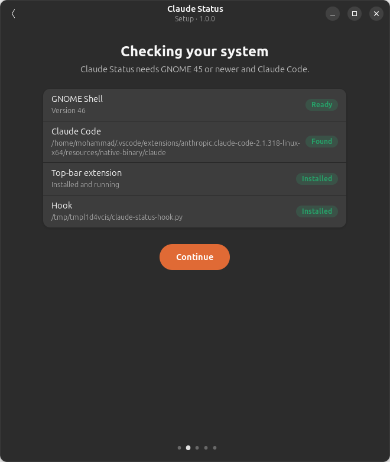
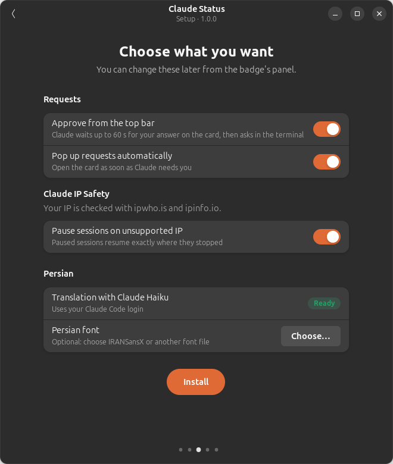

<div dir="rtl">

<div align="center">


# Claude Status

**بج وضعیت Claude Code در نوار بالای گنوم**

ببینید Claude در حال فکر کردن است، منتظر اجازهٔ شماست یا کارش تمام شده، و درخواست‌های مجوز را بدون ترک کاری که می‌کنید جواب بدهید.

[English](README.md) · [نصب](#نصب) · [نحوهٔ کار](#نحوهٔ-کار) · [پرسش‌های رایج](#پرسشهای-رایج)



</div>

## امکانات

- **وضعیت زنده در نوار بالا:** در حال فکر، منتظر اجازه، تمام شد یا بیکار. اسم پروژه، مدل (Opus 5.5، Sonnet 5.5 و…) و زمان نوبت فعلی هم کنارش دیده می‌شود.
- **تأیید از همان نوار بالا:** وقتی Claude اجازه می‌خواهد، کارتی از دل بج باز می‌شود و دستور دقیق را نشان می‌دهد. **Allow**، **Always allow** یا **Deny** را بزنید، یا تصمیم را به ترمینال بسپارید.
- **همهٔ جلسه‌ها یک‌جا:** با کلیک روی بج همهٔ جلسه‌های Claude Code را می‌بینید، دسته‌بندی‌شده به «منتظر شما»، «در حال کار» و «تمام‌شده».
- **ترجمهٔ فارسی:** با یک کلیک، سؤال Claude و گزینه‌هایش راست‌چین و با فونت IRANSansX به فارسی ترجمه می‌شوند. ترجمه با مدل Haiku و از طریق همان Claude Code نصب‌شده روی سیستم انجام می‌شود، پس کلید API جداگانه لازم نیست.
- **Claude IP Safety:** پنل، IP عمومی شما، موقعیتش و در دسترس بودن Claude در آن منطقه را نشان می‌دهد. اگر IP در منطقه‌ای باشد که Claude آن را پشتیبانی نمی‌کند، همهٔ جلسه‌های Claude Code همان لحظه متوقف می‌شوند، بج قرمز می‌شود و پنجره‌ای دلیلش را توضیح می‌دهد. با **Dismiss and continue** جلسه‌ها دقیقاً از همان‌جا ادامه پیدا می‌کنند.
- **انیمیشن مایع:** پنل‌ها مثل یک قطره از بج بیرون می‌آیند و بج هنگام جدا شدنشان کمی فشرده می‌شود.
- **امن به‌صورت پیش‌فرض:** اگر افزونه در حال اجرا نباشد یا تا ۶۰ ثانیه جواب ندهید، Claude Code مثل همیشه در ترمینال سؤال می‌پرسد.

| | |
|---|---|
|  |  |
|  |  |
|  |  |

## پیش‌نیازها

| | |
|---|---|
| میزکار | گنوم **۴۵، ۴۶، ۴۷، ۴۸ یا ۴۹** (Wayland یا X11) |
| Claude Code | نسخهٔ CLI یا افزونهٔ VS Code / Cursor |
| ابزار | `python3` (تقریباً روی همهٔ توزیع‌ها از قبل نصب است) |

روی Ubuntu 24.04 تست شده است و روی هر توزیعی که نسخهٔ پشتیبانی‌شدهٔ گنوم را دارد کار می‌کند:

| توزیع | نسخه‌ای که گنوم ۴۵ به بالا دارد |
|---|---|
| Ubuntu | ۲۴.۰۴ LTS و بالاتر |
| Fedora Workstation | ۳۹ و بالاتر |
| Debian | ۱۳ (trixie) و بالاتر |
| Arch Linux، Manjaro، EndeavourOS | نسخهٔ فعلی |
| openSUSE | Tumbleweed |
| Pop!_OS، Zorin OS، Vanilla OS | نسخه‌های مبتنی بر اوبونتو ۲۴.۰۴ یا بالاتر با گنوم |

KDE Plasma، Xfce، Cinnamon و COSMIC پشتیبانی نمی‌شوند، چون بج یک افزونهٔ گنوم است.

## نصب

### اوبونتو، دبیان، Pop!_OS و Zorin: بستهٔ ‎.deb (پیشنهادی)

۱. فایل `claude-status_1.0.0_all.deb` را از بخش [Releases](https://github.com/mohammad-mohammad-soltani/ClaudeAddonTools/releases) دانلود کنید و روی آن دوبار کلیک کنید، یا این دستور را اجرا کنید:

<div dir="ltr">

```bash
sudo apt install ./claude-status_1.0.0_all.deb
```

</div>

۲. برنامهٔ **Claude Status** را از منوی برنامه‌ها باز کنید. اگر بازش نکنید، دفعهٔ بعد که وارد سیستم شوید خودش باز می‌شود. این برنامه سیستم را بررسی می‌کند، گزینه‌ها را از شما می‌پرسد و همه‌چیز را به حساب Claude Code شما وصل می‌کند.

۳. در پایان، یک بار از حساب کاربری خارج شوید و دوباره وارد شوید، و جلسه‌های بازِ Claude Code را دوباره باز کنید.

| | | |
|---|---|---|
|  |  |  |

برای ساختن بسته توسط خودتان: `packaging/build-deb.sh` (فایل را در `dist/` می‌سازد).

### فدورا، آرچ، openSUSE و بقیه: اسکریپت نصب

<div dir="ltr">

```bash
git clone https://github.com/mohammad-mohammad-soltani/ClaudeAddonTools.git
cd ClaudeAddonTools
./install.sh
```

</div>

بعد از نصب:

۱. از حساب کاربری خارج شوید و دوباره وارد شوید. روی X11 می‌توانید به‌جایش <kbd>Alt</kbd>+<kbd>F2</kbd> را بزنید، `r` را تایپ کنید و Enter بزنید.

۲. اگر بج ظاهر نشد، این دستور را اجرا کنید: `gnome-extensions enable claude-status@mohammad-soltani`

۳. جلسه‌های بازِ Claude Code را دوباره باز کنید تا هوک‌ها را بخوانند.

نصب فقط برای کاربر فعلی انجام می‌شود و `sudo` لازم ندارد. قبل از تغییر فایل `~/.claude/settings.json` از آن نسخهٔ پشتیبان گرفته می‌شود (`settings.json.bak-claude-status`) و بقیهٔ تنظیمات شما دست نمی‌خورد. برای به‌روزرسانی همین اسکریپت را دوباره اجرا کنید. با `./install.sh --dev` افزونه به‌جای کپی، لینک می‌شود تا راحت روی کدش کار کنید.

### حذف

- بستهٔ ‎.deb: `sudo apt remove claude-status`
- اسکریپت: `./uninstall.sh`

## نحوهٔ کار

<div dir="ltr">

```
Claude Code ──hooks──▶ claude-status-hook.py ──writes──▶ ~/.cache/claude-status/
                                ▲                              │
                                │ responses/<id>.json          │ watched
                                │                              ▼
                                └──────────── GNOME extension (badge, panel, card)
```

</div>

۱. Claude Code در هر رویداد، مثل ارسال پیام، استفاده از ابزار، درخواست مجوز یا پایان کار، یک هوک کوچک پایتونی را اجرا می‌کند.

۲. هوک وضعیت هر جلسه را در یک فایل JSON در `~/.cache/claude-status/sessions/` می‌نویسد. افزونهٔ گنوم آن پوشه را زیر نظر دارد و بج را فوراً به‌روز می‌کند. هیچ چیزی مدام بررسی نمی‌شود و هیچ داده‌ای از سیستم شما خارج نمی‌شود.

۳. در درخواست مجوز، هوک فایل `requests/<id>.json` را می‌نویسد و منتظر می‌ماند. با زدن **Allow** روی کارت، فایل `responses/<id>.json` نوشته می‌شود و هوک تصمیم را به Claude Code برمی‌گرداند.

۴. اگر تا ۶۰ ثانیه جوابی نیاید یا افزونه در حال اجرا نباشد، هوک کنار می‌رود و Claude Code مثل همیشه در ترمینال سؤال می‌پرسد.

### Claude IP Safety

- IP عمومی شما هر ۵ دقیقه و با هر تغییر شبکه از طریق دو سرویس **ipwho.is** و **ipinfo.io** بررسی می‌شود. این دو سرویس IP شما را می‌بینند و چیز دیگری برایشان ارسال نمی‌شود.
- جلسه‌ها فقط وقتی متوقف می‌شوند که همهٔ سرویس‌هایی که جواب داده‌اند منطقه را غیرمجاز تشخیص بدهند، تا یک جواب اشتباه کار شما را متوقف نکند.
- توقف با فرستادن سیگنال `SIGSTOP` به همهٔ پروسه‌های Claude Code انجام می‌شود: نسخهٔ CLI و نسخه‌های داخل VS Code و Cursor. **Dismiss and continue** سیگنال `SIGCONT` می‌فرستد و برای همان IP دوباره متوقف نمی‌کند. دستورهایی که Claude از قبل اجرا کرده، مثل یک build در حال اجرا، متوقف نمی‌شوند.
- اگر افزونه غیرفعال شود یا صفحه قفل شود، جلسه‌های متوقف‌شده ادامه پیدا می‌کنند تا Claude هیچ‌وقت قفل نماند.
- فهرست پیش‌فرض مناطق غیرمجاز `CN HK MO RU BY IR KP SY CU` است و ممکن است دقیقاً با فهرست فعلی Anthropic یکی نباشد. [فهرست کشورهای پشتیبانی‌شدهٔ Anthropic](https://www.anthropic.com/supported-countries) را ببینید و در صورت نیاز فهرست را در `~/.cache/claude-status/prefs.json` تغییر دهید:

<div dir="ltr">

```json
{ "unsupportedCountries": ["CN", "RU", "IR"] }
```

</div>

### تنظیمات

| چه چیزی | چطور |
|---|---|
| باز نشدن خودکار کارت درخواست | گزینهٔ **Pop up requests automatically** را در پنل خاموش کنید |
| متوقف نشدن جلسه‌ها روی IP غیرمجاز | گزینهٔ **Pause sessions on unsupported IP** را در پنل خاموش کنید |
| تغییر مدت انتظار کارت | متغیر `CLAUDE_STATUS_WAIT=30` را تنظیم کنید (بر حسب ثانیه، پیش‌فرض `60`) |
| استفاده از پوشهٔ تنظیمات دیگری برای Claude | قبل از نصب، `CLAUDE_CONFIG_DIR` را تنظیم کنید |

## پرسش‌های رایج

**بج نمایش داده نمی‌شود.**
مطمئن شوید بعد از نصب از حساب خارج شده‌اید و دوباره وارد شده‌اید. بعد `gnome-extensions info claude-status@mohammad-soltani` را اجرا کنید. اگر وضعیت `ERROR` بود، خروجی `journalctl --user -b -o cat /usr/bin/gnome-shell | grep -i claude` را در یک issue بفرستید.

**بج روی حالت بیکار می‌ماند.**
Claude Code را دوباره باز کنید، چون هوک‌ها موقع شروع جلسه خوانده می‌شوند. بررسی کنید که در `~/.claude/settings.json` ورودی‌هایی وجود داشته باشد که `claude-status-hook.py` را اجرا می‌کنند.

**دکمهٔ ترجمه می‌گوید «Claude Code CLI not found».**
افزونه `claude` را در `PATH`، در `~/.local/bin` و `~/.claude/local`، و داخل افزونه‌های VS Code، Cursor و VSCodium جستجو می‌کند. نصب CLI با دستور `npm i -g @anthropic-ai/claude-code` مشکل را حل می‌کند.

**ترجمه هزینه دارد؟**
ترجمه با `claude -p --model haiku` و با همان حساب Claude Code شما انجام می‌شود، پس از سهمیهٔ معمول مصرف شما کم می‌کند. هر سؤال فقط یک بار ترجمه و ذخیره می‌شود.

**چرا کارت سؤال فقط نمایشی است؟**
هوک‌های Claude Code می‌توانند اجرای یک ابزار را مجاز یا رد کنند، اما نمی‌توانند به‌جای شما جواب تایپ کنند. برای همین جواب سؤال‌ها در ترمینال داده می‌شود.

**با Esc کار را قطع کردم و بج هنوز «Thinking» نشان می‌دهد.**
وقتی کار قطع می‌شود، رویداد پایان ارسال نمی‌شود. بج بعد از ۲۰ دقیقه بدون به‌روزرسانی خودش به حالت بیکار برمی‌گردد. می‌توانید از داخل پنل هم پاکش کنید.

**برنامهٔ تنظیم از داخل ترمینال VS Code باز نمی‌شود.**
VS Code وقتی به‌صورت snap نصب شده باشد، متغیرهایی به ترمینال می‌دهد که برنامه‌های GTK را خراب می‌کند. برنامه را از منوی برنامه‌ها باز کنید.

## توسعه

<div dir="ltr">

```
extension/claude-status@mohammad-soltani/
  extension.js    badge + session panel
  card.js         request card
  store.js        watches ~/.cache/claude-status
  translator.js   Persian translation through the Claude Code CLI (Haiku)
  ipsafety.js     IP lookup, pause (SIGSTOP) and resume (SIGCONT)
  alert.js        the unsupported-IP alert
  stylesheet.css
hooks/claude-status-hook.py   Claude Code hook
packaging/setup/              graphical setup wizard (GTK 4 + libadwaita)
packaging/build-deb.sh        builds the .deb
docs/showcase/                source of the README images (render.sh, shot-setup.py)
```

</div>

تصاویر انگلیسی و فارسی با `docs/showcase/render.sh` ساخته می‌شوند. متن تصاویر فارسی با فونت لحظه (Lahzeh) نوشته شده است.

## مجوز

[MIT](LICENSE) © mohammad mohammad soltani

Claude و لوگوی Claude علامت تجاری Anthropic هستند. این پروژه مستقل است و ارتباطی با Anthropic ندارد و از طرف آن تأیید نشده است.

</div>
