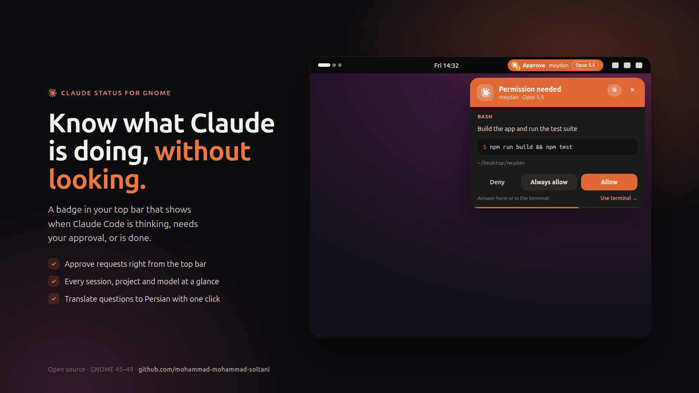
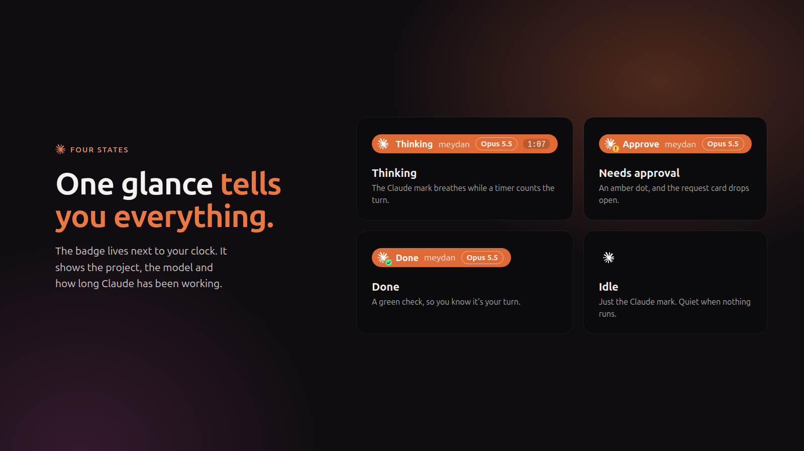
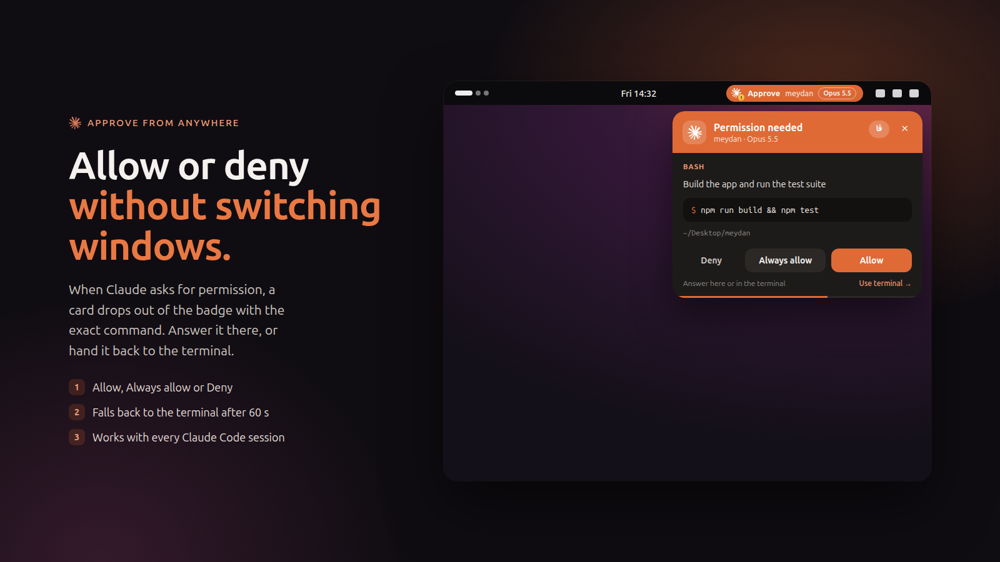
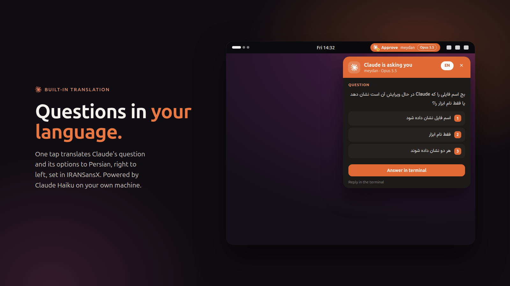
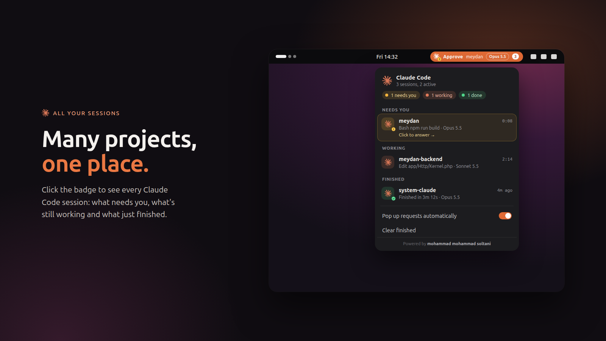
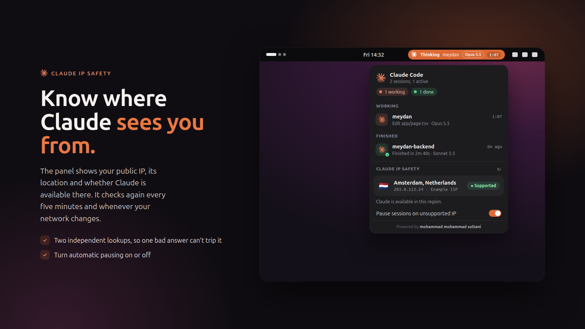
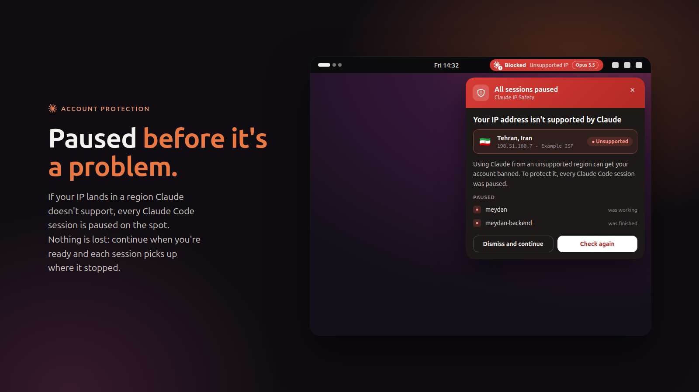
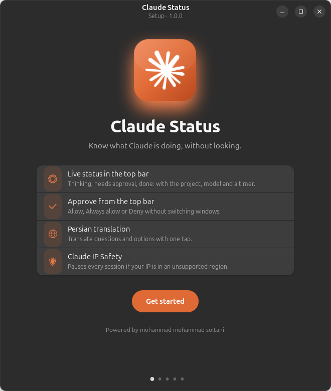
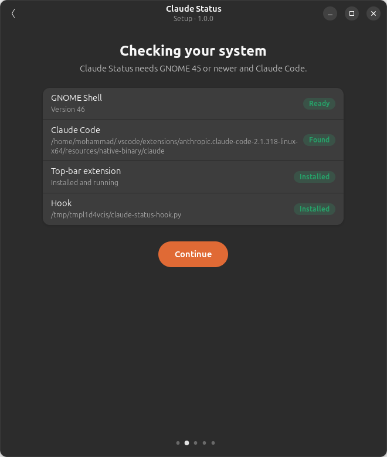
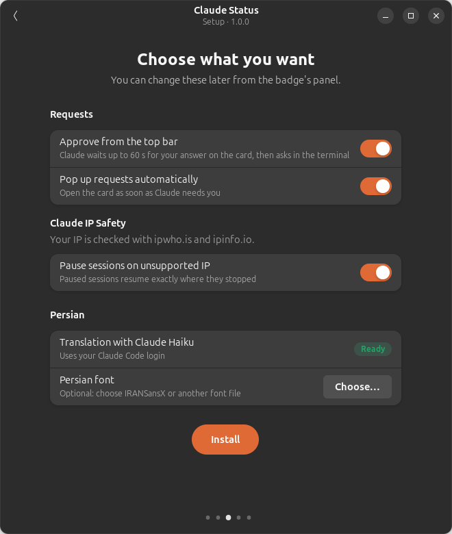

<div align="center">


# Claude Status

**A top-bar badge for Claude Code on GNOME.**
See when Claude is thinking, needs your approval, or is done, and answer permission requests without leaving what you're doing.

[فارسی](README.fa.md) · [Install](#install) · [How it works](#how-it-works) · [FAQ](#faq)



</div>

## Features

- **Live status in the top bar.** Thinking, Needs approval, Done, or Idle, with the project name, the model (Opus 5.5, Sonnet 5.5…) and a timer for the current turn.
- **Approve from the top bar.** When Claude asks for permission, a card drops out of the badge with the exact command. Choose **Allow**, **Always allow** or **Deny**, or hand it back to the terminal.
- **Every session in one place.** Click the badge to see all Claude Code sessions grouped by what needs you, what's working and what's finished.
- **Persian translation.** One tap translates Claude's question and its options to Persian, right to left, set in IRANSansX. It uses Claude Haiku through the Claude Code CLI you already have, so there's no extra API key.
- **Claude IP Safety.** The panel shows your public IP, its location and whether Claude is available there. If the IP is in a region Claude doesn't support, every Claude Code session is paused on the spot, the badge turns red and an alert explains why. **Dismiss and continue** resumes them exactly where they stopped.
- **Liquid motion.** Panels grow out of the badge like a drop, and the badge squashes as they leave it.
- **Safe by default.** If the extension isn't running, or you don't answer within 60 seconds, Claude Code falls back to its normal terminal prompt.

| | |
|---|---|
|  |  |
|  |  |
|  |  |

## Requirements

| | |
|---|---|
| Desktop | GNOME Shell **45, 46, 47, 48 or 49** (Wayland or X11) |
| Claude Code | CLI or the VS Code / Cursor extension |
| Tools | `python3` (preinstalled on nearly every distro) |

Tested on Ubuntu 24.04. It works on any distribution that ships a supported GNOME version:

| Distribution | Version with GNOME 45+ |
|---|---|
| Ubuntu | 24.04 LTS and newer |
| Fedora Workstation | 39 and newer |
| Debian | 13 (trixie) and newer |
| Arch Linux, Manjaro, EndeavourOS | current |
| openSUSE | Tumbleweed |
| Pop!_OS, Zorin OS, Vanilla OS | releases based on Ubuntu 24.04 or newer, using GNOME |

KDE Plasma, Xfce, Cinnamon and COSMIC aren't supported. The badge is a GNOME Shell extension.

## Install

### Ubuntu, Debian, Pop!_OS, Zorin: the .deb (recommended)

1. Download `claude-status_1.0.0_all.deb` from [Releases](https://github.com/mohammad-mohammad-soltani/ClaudeAddonTools/releases) and double-click it, or run:
   ```bash
   sudo apt install ./claude-status_1.0.0_all.deb
   ```
2. Open **Claude Status** from your apps. It also opens by itself on your next login. The setup wizard checks your system, lets you pick what you want and connects everything to your Claude Code account.

| | | |
|---|---|---|
|  |  |  |

To build the package yourself: `packaging/build-deb.sh` (writes `dist/claude-status_<version>_all.deb`).

### Fedora, Arch, openSUSE and others: the script

```bash
git clone https://github.com/mohammad-mohammad-soltani/ClaudeAddonTools.git
cd ClaudeAddonTools
./install.sh
```

Then:

1. **Log out and back in.** On X11 you can press <kbd>Alt</kbd>+<kbd>F2</kbd>, type `r`, and press <kbd>Enter</kbd> instead.
2. If the badge doesn't appear, run `gnome-extensions enable claude-status@mohammad-soltani`.
3. Restart any open Claude Code sessions so they load the hooks.

The installer works per user and never asks for `sudo`. It:

- copies the extension to `~/.local/share/gnome-shell/extensions/`
- copies the hook to `~/.local/share/claude-status/`
- adds hook entries to `~/.claude/settings.json` and keeps a backup next to it (`settings.json.bak-claude-status`); your other settings are left alone
- installs the Persian font from `fonts/`, if one is there

Run `./install.sh` again to update. Use `./install.sh --dev` to symlink the extension while you work on it.

### Uninstall

```bash
./uninstall.sh
```

This removes the extension, the hook entries, the font and the cached state. Log out and back in to remove the badge.

## How it works

```
Claude Code ──hooks──▶ claude-status-hook.py ──writes──▶ ~/.cache/claude-status/
                                ▲                              │
                                │ responses/<id>.json          │ watched
                                │                              ▼
                                └──────────── GNOME extension (badge, panel, card)
```

1. Claude Code runs the hook on each event: `UserPromptSubmit`, `PreToolUse`, `PermissionRequest`, `Stop` and the others.
2. The hook writes a small JSON file per session in `~/.cache/claude-status/sessions/`. The extension watches that folder and updates the badge right away. Nothing is polled and nothing leaves your machine.
3. On a permission request the hook writes `requests/<id>.json` and waits. Clicking **Allow** on the card writes `responses/<id>.json`. The hook passes the decision back to Claude Code through the documented `PermissionRequest` hook output.
4. If there's no answer within 60 seconds, or the extension isn't running, the hook steps aside and Claude Code asks in the terminal as usual.

### Claude IP Safety

- Your public IP is looked up through **ipwho.is** and **ipinfo.io** every 5 minutes and whenever your network changes. These two services see your IP address; nothing else is sent.
- Sessions are paused only when every lookup that answered places you in an unsupported region, so one wrong answer can't pause your work.
- Pausing sends `SIGSTOP` to every Claude Code process you own: the CLI and the copies inside VS Code and Cursor. **Dismiss and continue** sends `SIGCONT`, and the extension won't pause again for the same IP. Commands Claude already started, like a running build, aren't paused.
- When the extension is disabled, or GNOME locks the screen, paused sessions are resumed so Claude is never left frozen.
- The default list of unsupported regions is `CN HK MO RU BY IR KP SY CU`. It may not match Anthropic's current list exactly; check [Anthropic's supported countries](https://www.anthropic.com/supported-countries) and override it in `~/.cache/claude-status/prefs.json`:
  ```json
  { "unsupportedCountries": ["CN", "RU", "IR"] }
  ```

### Settings

| What | How |
|---|---|
| Stop cards from popping up | Turn off **Pop up requests automatically** in the panel |
| Stop pausing on an unsupported IP | Turn off **Pause sessions on unsupported IP** in the panel |
| Change how long the card waits | Set `CLAUDE_STATUS_WAIT=30` in your environment (seconds, default `60`) |
| Use another Claude config folder | Set `CLAUDE_CONFIG_DIR` before running `install.sh` |

## FAQ

**The badge doesn't show up.**
Make sure you logged out and back in after installing, then check `gnome-extensions info claude-status@mohammad-soltani`. If the state is `ERROR`, run `journalctl --user -b -o cat /usr/bin/gnome-shell | grep -i claude` and open an issue with the output.

**The badge stays on Idle.**
Restart Claude Code: hooks load when a session starts. Check that `~/.claude/settings.json` has entries that run `claude-status-hook.py`.

**Translate says "Claude Code CLI not found".**
The extension looks for `claude` in your `PATH`, in `~/.local/bin`, `~/.claude/local`, and inside the VS Code, Cursor and VSCodium extensions. Installing the CLI with `npm i -g @anthropic-ai/claude-code` fixes it.

**Does translation cost money?**
It runs `claude -p --model haiku` with your existing Claude Code login, so it counts toward your normal Claude usage. Each question is translated once and cached.

**Why is a question card display-only?**
Claude Code hooks can allow or deny a tool call, but they can't type an answer for you, so questions are answered in the terminal.

**I interrupted Claude with Esc and the badge still says Thinking.**
An interrupted turn doesn't send a `Stop` event. The badge returns to Idle after 20 minutes without updates, or you can clear it from the panel.

## Development

```
extension/claude-status@mohammad-soltani/
  extension.js    badge + session panel
  card.js         request card
  store.js        watches ~/.cache/claude-status
  translator.js   Persian translation through the Claude Code CLI (Haiku)
  ipsafety.js     IP lookup, pause (SIGSTOP) and resume (SIGCONT)
  alert.js        the unsupported-IP alert
  stylesheet.css
hooks/claude-status-hook.py   Claude Code hook
packaging/setup/              graphical setup wizard (GTK 4 + libadwaita)
packaging/build-deb.sh        builds the .deb
docs/showcase/                source of the README images (render.sh, shot-setup.py)
```

```bash
./install.sh --dev                        # symlink for live editing
journalctl --user -f -o cat /usr/bin/gnome-shell   # watch logs
```

On Wayland you have to log out and back in to reload the code. A nested shell is quicker: `dbus-run-session -- gnome-shell --nested --wayland` on GNOME 45–48, or `gnome-shell --devkit` on 49.

## License

[MIT](LICENSE) © mohammad mohammad soltani

Claude and the Claude logo are trademarks of Anthropic. This is an independent community project and isn't affiliated with or endorsed by Anthropic.
